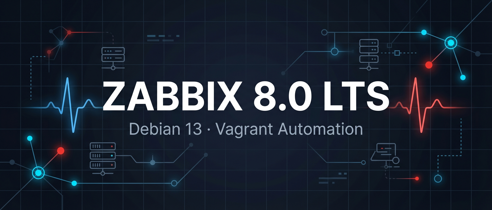
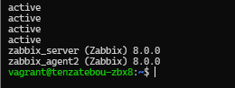
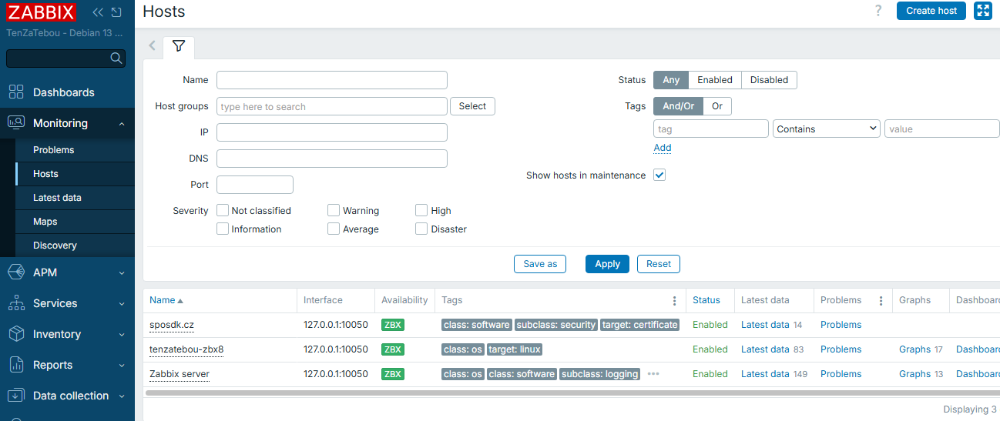
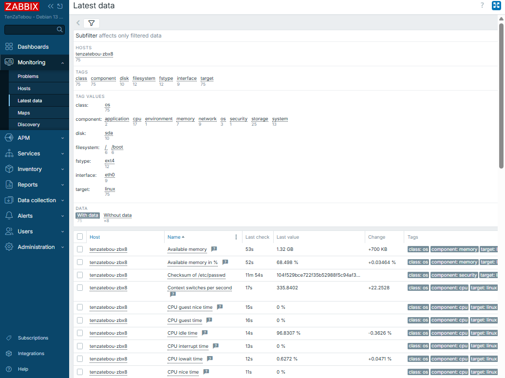
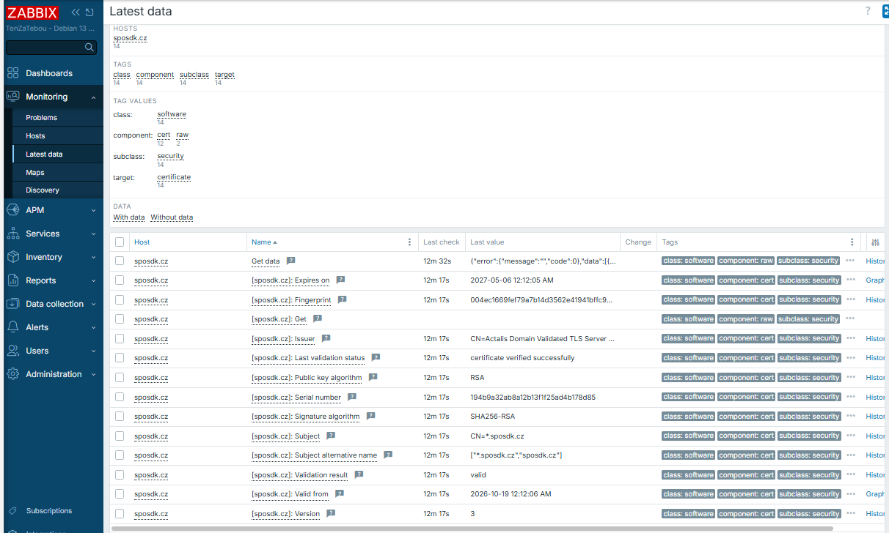



# Automatizovaná instalace Zabbix 8.0 LTS na Debianu 13

Reprodukovatelná a idempotentní instalace monitorovacího systému **Zabbix 8.0 LTS** (server, webový frontend, **MariaDB**, **Apache** a **Zabbix Agent 2**) ve virtuálním stroji **Debian 13 (`bento/debian-13`)** pomocí nástroje **Vagrant**.

- **Webové rozhraní:** `http://127.0.0.1:8080/zabbix` (port je přesměrován pouze na lokální rozhraní `127.0.0.1`)
- **Záhlaví serveru ve webu:** `TenZaTebou - Debian 13 - Zabbix 8`
- **Parametry VM:** 2 CPU, 2048 MB RAM, hostname `tenzatebou-zbx8`, SSH na `127.0.0.1:2211`

## Předpoklady a spuštění

Na hostitelském počítači je potřeba mít nainstalovaný **Vagrant**, **VirtualBox**, aktivní připojení k internetu a alespoň 2 GB volné operační paměti.

1. **Validace a první spuštění virtuálního stroje:**
   ```bash
   vagrant validate
   vagrant up
   ```
2. **Připojení přes SSH a ověření opakovatelnosti (idempotence):**
   ```bash
   vagrant ssh
   vagrant provision
   ```
   Při opakovaném spuštění `vagrant provision` skript ověří existenci databáze i hostů – databázové schéma znovu neimportuje a dosud naměřená data zůstanou zachována.

## Co bylo v projektu vytvořeno

- **`Vagrantfile`** – definuje virtuální stroj na bázi oficiálního boxu `bento/debian-13` (2 CPU, 2048 MB RAM), nastavuje přesměrování portů (`127.0.0.1:8080` → `80` pro webové rozhraní a `127.0.0.1:2211` → `22` pro SSH), nahrává konfigurační soubory (`scripts/configure-hosts.php` a `Zabbix/export/sposdk.cz_hosts.yaml`) do `/tmp/` pomocí `file` provisioneru a spouští instalační skript `scripts/install.sh` s parametrem `binary: false` (automatický převod konců řádků z Windows CRLF na Linux LF).
- **`scripts/install.sh`** – shellový instalační skript řízený pomocí `set -eu` (při jakékoliv chybě se okamžitě ukončí s nenulovým návratovým kódem). Přidá oficiální repozitář Zabbix 8.0 pro Debian 13, nainstaluje MariaDB, Zabbix server, PHP frontend, Apache a Zabbix Agent 2. Vytvoří databázi `zabbix` (`utf8mb4`) a databázového uživatele `zabbix` s oprávněním pouze k této databázi. Databázové schéma naimportuje pouze při prvním spuštění (kontrola existence tabulky `dbversion`). Rovnou vygeneruje `/etc/zabbix/web/zabbix.conf.php` s vlastním názvem serveru v záhlaví, takže odpadá ruční klikání instalačního PHP průvodce.
- **`scripts/configure-hosts.php`** – PHP skript komunikující se Zabbix 8.0 JSON-RPC API (`Authorization: Bearer`). Po startu serveru vytvoří skupinu hostů `SPOS Lab`, založí lokálního hosta `tenzatebou-zbx8` se šablonou *Linux by Zabbix agent* (komunikace přes Zabbix Agent 2 na `127.0.0.1:10050`), naimportuje exportovaný host `Zabbix/export/sposdk.cz_hosts.yaml` se šablonou *Website certificate by Zabbix agent 2* pro kontrolu TLS certifikátu `https://sposdk.cz` a změní výchozí heslo administrátorského účtu `Admin`.
- **`.gitignore`** – vylučuje z verzování pracovní adresář `.vagrant/`, dočasné logy a jakékoliv soubory s hesly.

## Bezpečná práce s hesly

V repozitáři ani v historii Gitu nejsou uložená žádná hesla. Heslo k databázi MariaDB i přihlašovací heslo pro webový účet `Admin` se generují kryptograficky náhodně až při prvním spuštění uvnitř virtuálního stroje:

- `/var/lib/zabbix-install/db-password` (oprávnění `0600`, vlastník `root`)
- `/var/lib/zabbix-install/admin-password` (oprávnění `0600`, vlastník `root`)

Aktuální přihlašovací heslo pro uživatele `Admin` lze zobrazit pouze uvnitř VM příkazem:

```bash
sudo cat /var/lib/zabbix-install/admin-password
```

## Ověření a snímky obrazovky

### 1. Stav služeb a verze komponent v terminálu


Výstup příkazů `sudo systemctl is-active mariadb zabbix-server zabbix-agent2 apache2`, `sudo zabbix_server -V` a `sudo zabbix_agent2 -V` uvnitř VM. Potvrzuje, že všechny čtyři klíčové služby běží (`active`) a server i agent používají verzi **Zabbix 8.0.0** (bez zobrazení přihlašovacího hesla na snímku).

### 2. Webové rozhraní a přehled monitorovaných hostů


Přehled v sekci **Monitoring → Hosts** na adrese `http://127.0.0.1:8080/zabbix`. V levém horním záhlaví je zobrazen vlastní název serveru `TenZaTebou - Debian 13 - Zabbix 8`. Oba monitorované hosty (`tenzatebou-zbx8` i `sposdk.cz`) mají zelený indikátor dostupnosti **`ZBX`** a aktivně sbírají data.

### 3. Monitoring lokálních prostředků virtuálního stroje (`tenzatebou-zbx8`)


Pohled do **Monitoring → Latest data** pro hosta `tenzatebou-zbx8`. Zobrazuje aktuální hodnoty načtené přes Zabbix Agent 2 (využití CPU, dostupnou operační paměť, kontrolní součty a časy poslední kontroly *Last check*).

### 4. Monitoring TLS/SSL certifikátu webu `https://sposdk.cz`


Pohled do **Monitoring → Latest data** pro naimportovaného hosta `sposdk.cz` využívajícího šablonu *Website certificate by Zabbix agent 2*. Potvrzuje úspěšné ověření certifikátu (`Validation result: valid`, `certificate verified successfully`), zobrazení vydavatele (`Issuer`), předmětu (`CN=*.sposdk.cz`) i data expirace (`2027-05-06`).

## Řešení potíží

- **Název šablony pro Linux v Zabbixu 8.0:** V Zabbixu 8.0 neexistuje samostatná šablona *Linux by Zabbix agent 2*; Zabbix Agent 2 používá standardní šablonu **`Linux by Zabbix agent`**.
- **Propojení šablony při importu přes API:** Při importu souboru `sposdk.cz_hosts.yaml` metodou `configuration.import` bylo nutné v pravidlech explicitně povolit `templateLinkage`, aby se šablona *Website certificate by Zabbix agent 2* k hostovi `sposdk.cz` automaticky připojila.
- **Čekání na start Zabbix API:** Po restartu služby `zabbix-server` trvá několik sekund, než server inicializuje cache a začne přijímat požadavky na API. Skript `configure-hosts.php` proto obsahuje opakovací smyčku (až 60 s) před přihlášením.
- **Konce řádků CRLF na Windows:** Aby v Debianu neselhával interpret `#!/bin/bash` kvůli znakům `\r`, skripty se ukládají s konci řádků LF a v `Vagrantfile` je nastaveno `binary: false`.
